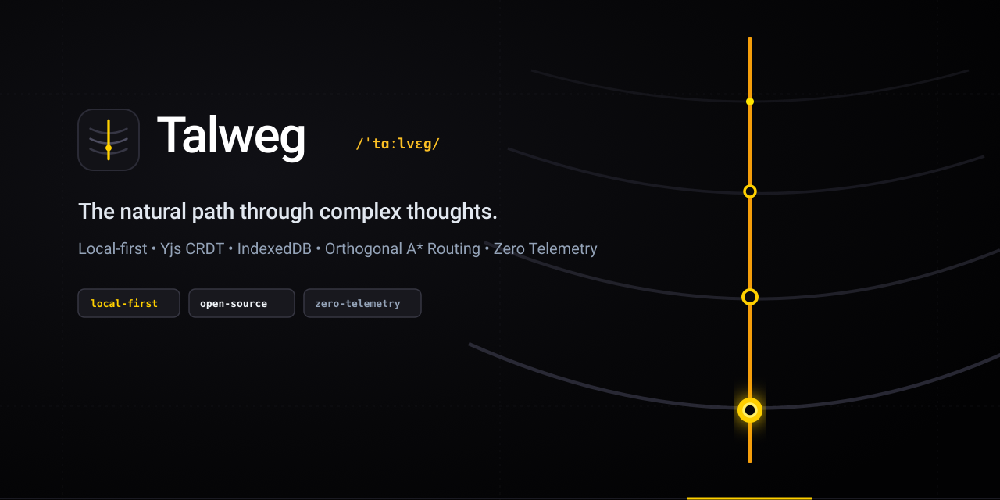

<p align="center">
  
</p>

<p align="center">
  <strong>Local-first, zero-telemetry visual thinking canvas, architecture diagrams, and keyboard-driven mindmaps.</strong>
</p>

<p align="center">
  <a href="./LICENSE"></a>
  
  
  
  
</p>

---

## What is Talweg?

In geography, a **talweg** (`/ˈtɑːlvɛɡ/`, German: *Tal* [valley] + *Weg* [path]) is the deepest continuous channel running along a valley floor. It is the natural path water takes to navigate rough topography with minimal friction.

**Talweg** applies that law to visual thinking. When architecture diagrams, technical plans, and exploratory thoughts sprawl across a screen, Talweg routes connections around obstacles automatically, keeping all personal data strictly inside your local browser storage.

- **100% Local-first:** boards and graph states live in IndexedDB with transactional compaction. No remote server required.
- **CRDT Synchronization:** built on top of Yjs, ready for peer-to-peer conflict-free synchronization.
- **Orthogonal Obstacle Routing:** connectors calculate optimal orthogonal A* paths around cards, sticky notes, and clusters automatically.
- **Three Modes in One Interface:** Whiteboard freeform sketching, Structured Technical Diagrams, and Rapid Keyboard-driven Mindmaps (Tab for child node, Enter for sibling).

---

## Monorepo Architecture

Talweg is structured as an isolated pnpm + Turbo monorepo:

```text
talweg/
├── apps/
│   └── web/            # React 19 + Vite + Tailwind CSS canvas application
├── packages/
│   ├── core/           # Scene graph, fractional indexing, affine camera transforms
│   ├── router/         # Orthogonal A* pathfinder with obstacle inflation and rounded corners
│   └── storage/        # Yjs CRDT scene bindings and transactional IndexedDB adapter
└── assets/
    └── branding/       # Vector SVGs, org avatars, and social preview assets
```

### Core Packages

* **`@talweg/core`:** Canvas node graph (cards, stickers, rectangles, arrows, groups), coordinate math, fractional z-indexing, and camera projection.
* **`@talweg/router`:** Pathfinding engine that dynamically computes orthogonal connector trajectories avoiding node bounding boxes.
* **`@talweg/storage`:** Dual-layer storage adapter combining local IndexedDB persistence with Yjs operational CRDT records.

---

## Quick Start

### Prerequisites

* Node.js >= 22.12.0
* pnpm >= 12.0.0

### Local Development

```bash
# Clone repository
git clone git@github.com:talweg-app/talweg.git
cd talweg

# Install dependencies across all packages
pnpm install

# Run web app in development mode
pnpm dev
```

Open `http://localhost:5173` in your browser.

### Monorepo Commands

```bash
pnpm build        # Build all packages via Turbo
pnpm test         # Run test suites with v8 coverage across core, router, and storage
pnpm typecheck    # Validate TypeScript types
pnpm lint         # Run ESLint rules
```

---

## Keyboard Shortcuts

| Shortcut | Action |
| :--- | :--- |
| `V` | Selection tool |
| `H` / Space + Drag | Pan canvas |
| `R` | Add rectangle / block |
| `S` | Add sticky note |
| `C` | Add card with tags and status |
| `A` | Connect nodes with smart orthogonal arrow |
| `Tab` *(Mindmap mode)* | Append child thought node |
| `Enter` *(Mindmap mode)* | Append sibling thought node |
| `Ctrl + Z` / `Ctrl + Y` | Undo / Redo |
| `Delete` / `Backspace` | Remove selected nodes |

---

## Roadmap

- [x] Scene graph foundation with fractional indexing and camera transformations
- [x] Orthogonal A* connector routing around obstacles
- [x] IndexedDB storage with delta logs and atomic snapshot compaction
- [x] Dual-language UI (English / Russian)
- [ ] Export to clean standalone SVG, JSON, and Markdown outlines
- [ ] Ephemeral P2P collaboration via WebRTC
- [ ] Native desktop bundle via Tauri (Linux, macOS, Windows)

---

## License

Released under the [MIT License](./LICENSE).
