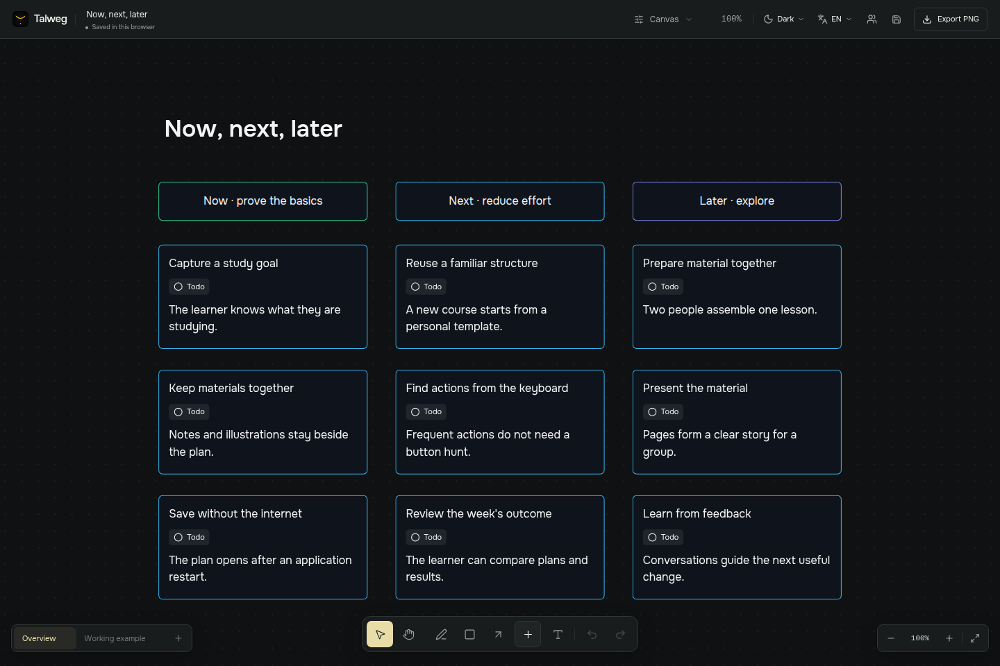
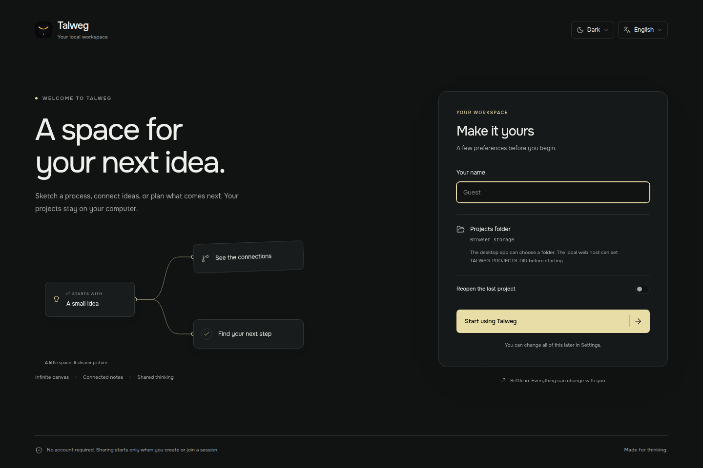

<p align="center"></p>

<h1 align="center">Talweg</h1>

<p align="center">Локальное пространство для схем, связанных заметок и планов.</p>

<p align="center">
  <a href="README.md">English</a> · Русский · <a href="docs/user-guide.ru.md">Инструкция</a> · <a href="https://github.com/talweg-app/talweg/releases">Сборки</a>
</p>

<picture>
  <source media="(prefers-color-scheme: light)" srcset="docs/media/canvas-light.png" />
  
</picture>

Соберите схему, задачи и объяснение на одной доске. Добавляйте независимые страницы, когда тема разрастается. Храните проекты файлами на своём компьютере и приглашайте другого человека в сессию совместного редактирования.

## Начать работу

Первая публичная бета доступна для Windows и Linux. Версия приложения **0.1.0-beta.1** опубликована под тегом **v0.1.0-beta**.

| Платформа | Скачать |
| --- | --- |
| Windows x64 | [Установщик (.exe)](https://github.com/talweg-app/talweg/releases/download/v0.1.0-beta/Talweg-0.1.0-beta.1-win-x64.exe) |
| Linux x64 | [AppImage](https://github.com/talweg-app/talweg/releases/download/v0.1.0-beta/Talweg-0.1.0-beta.1-linux-x86_64.AppImage) |

[Описание релиза и контрольные суммы](https://github.com/talweg-app/talweg/releases/tag/v0.1.0-beta). Запуск из исходников:

```bash
git clone https://github.com/talweg-app/talweg.git
cd talweg
pnpm install --frozen-lockfile
pnpm dev
```

Нужны **Node.js 22.12+** и **pnpm 12.14.0**. Откройте [localhost:5173](http://localhost:5173). Локальный сервер сохраняет рабочие проекты в папку `projects/`, которая исключена из Git. Команды сборки приложения есть в [инструкции для разработки](docs/development.md).

## Что можно делать

- Рисовать ручкой, соединять фигуры стрелками, добавлять фотографии, таблицы и списки задач.
- Менять заливку, обводку и текст через правый клик. Оформлять отдельное слово и добавлять внешние ссылки.
- Прикреплять Markdown-заметки с формулами LaTeX и связывать текст с объектами на других страницах доски.
- Объединять объекты в группы и проверять предварительное расположение перед упорядочиванием.
- Строить интеллект-карту с клавиатуры: Tab добавляет дочернюю мысль, Enter соседнюю.
- Переключать тему и язык, менять масштаб интерфейса независимо от масштаба холста.

<table>
  <tr>
    <td width="50%"><picture><source media="(prefers-color-scheme: light)" srcset="docs/media/planning-light.png" /></picture></td>
    <td width="50%"></td>
  </tr>
  <tr><td>Задачи рядом с контекстом.</td><td>Объяснение рядом с примером.</td></tr>
</table>

В библиотеке **12 шаблонов**: от карты исследования и плана недели до разбора инцидента. Сам просмотр шаблона не засоряет недавние доски. После редактирования он становится вашим рабочим проектом.

## Совместная работа

Откройте **Совместная работа → Начать сессию**, скопируйте приглашение `talweg://` и передайте его гостю. Гость открывает свой Talweg, выбирает **Подключиться к сессии** и вставляет приглашение. Хост подтверждает запрос.


[Смотреть или скачать MP4](docs/media/collaboration.mp4). Запись сделана в двух браузерных сессиях на одном компьютере через локальный relay.

Видны курсоры участников, выделенные объекты, перемещение, изменение размера и рисование. При редактировании текста отображаются чужие выделения и каретки. Каждый участник сам выбирает страницу и положение камеры.

Хост должен держать доску открытой. Для поиска участников используются сетевые сервисы; в некоторых сетях нужен TURN. Приглашение содержит данные доступа, поэтому публиковать его не стоит. Подробнее: [руководство](docs/user-guide.ru.md#совместная-работа) и [описание P2P](docs/collaboration.md).

## Файлы и сохранение

При первом запуске приложения можно выбрать язык, тему, имя и папку проектов. По умолчанию проекты лежат в системной папке «Документы», внутри `Talweg`. Файл `.talweg` включает страницы и встроенные изображения, поэтому его можно перенести на другой компьютер целиком.



Автоматическая история и именованные контрольные точки доступны при подключённой папке проектов. Старую версию можно просмотреть, скачать или восстановить отдельной доской. У истории есть ограничения хранения; для важных работ нужна отдельная резервная копия.

**Скрыть** убирает доску из текущего списка. **Удалить** после подтверждения удаляет проект вместе с его историей. Подробности: [файлы и восстановление](docs/files-and-recovery.md).

## Что учитывать в бете

Windows и Linux остаются основными платформами. macOS отложена до появления Mac для сборки и проверки. Windows-установщик пока не подписан.

Автоматические проверки охватывают независимые браузерные сессии и настоящий WebRTC-канал. Перед публикацией автор также проверил Windows и P2P вручную. В сетях с ограничениями всё ещё может понадобиться TURN. Ролей «только просмотр» и постоянно доступных серверных комнат пока нет. Одновременное изменение одного и того же форматирования текста или структуры списка может конфликтовать.

Для локальной работы интернет не нужен. Сессии совместного редактирования используют сетевые подключения. В браузерном режиме без локального сервера данные привязаны к адресу сайта и профилю браузера.

## Дальше

[Инструкция пользователя](docs/user-guide.ru.md) · [Документация](docs/README.md) · [Разработка](docs/development.md) · [Участие в проекте](CONTRIBUTING.md) · [Изменения](CHANGELOG.md)

Лицензия [MIT](LICENSE). Автор: [@ivanchik-byte](https://github.com/ivanchik-byte) · заметки о разработке и обновления в Telegram [@ivanchik_byte](https://t.me/ivanchik_byte).
