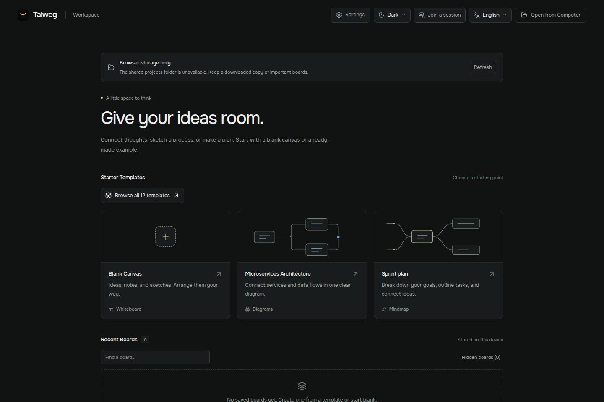

# Talweg documentation

[Project overview](../README.md) · [Русская инструкция](user-guide.ru.md)

Start with the [user guide](user-guide.md) to make your first board. The rest of the documentation follows the questions that tend to come next.

| Question | Guide |
| --- | --- |
| How do I draw, connect objects and format a word? | [Using the canvas](user-guide.md) |
| How do I invite someone and keep a copy? | [Collaboration](collaboration.md) |
| Where are projects stored, and what should I back up? | [Files and recovery](files-and-recovery.md) |
| How do I run, test and package Talweg? | [Development](development.md) |
| How do I report a bug or propose a change? | [Contributing](../CONTRIBUTING.md) |
| What is in the current candidate? | [Changelog](../CHANGELOG.md) |
| How do I set up the repository presentation and publish a beta? | [GitHub presentation](github-presentation.md) |
| Which names are owned, and how do we publish a useful npm package? | [Names and packages](names-and-packages.md) |

## See it in use

[MP4 recording](media/collaboration.mp4) · [Template gallery](media/templates.png) · [Math lesson](media/math-light.png) · [Planning board](media/planning-dark.png)

These are captures of the running application using built-in examples. The collaboration recording uses two browser sessions on one computer and the local relay. It demonstrates shared editing, not cross-network connectivity.

## Beta status

These guides describe `0.1.0-beta.1`, published under the [v0.1.0-beta tag](https://github.com/talweg-app/talweg/releases/tag/v0.1.0-beta). The desktop targets are Windows and Linux; macOS is deferred. See [beta limitations](../README.md#beta-boundaries) before relying on a shared session for important work.
