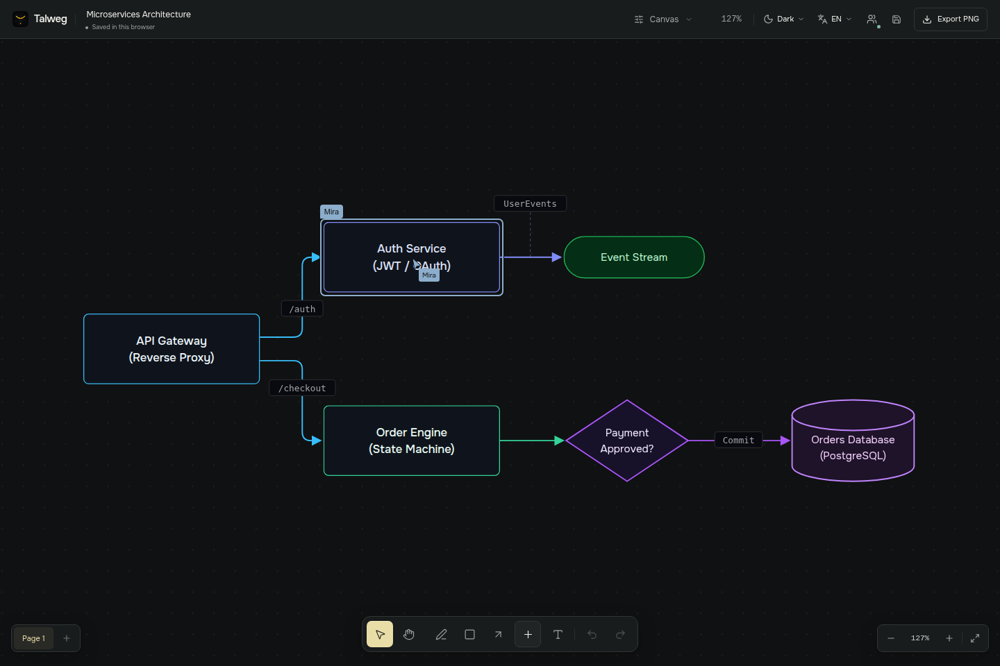
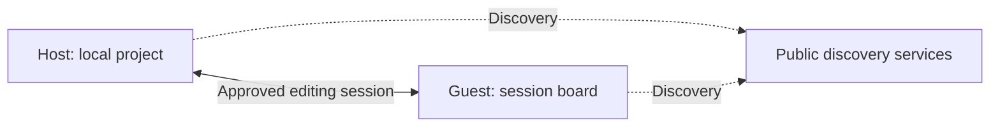

# Working together

[Documentation](README.md) · [Русская инструкция](user-guide.ru.md#совместная-работа)

Talweg shares one live board between a host and approved guests. Everyone in the session can edit. It does not require a Talweg account, and it does not provide a permanently hosted copy of the board.

## Create and share an invitation

1. Open the board you want to share.
2. Choose **Collaborate → Start a session**.
3. Choose **Copy invitation** and send the complete text privately.
4. Keep the board open and approve each guest with **Allow**.

The invitation starts with `talweg://join/`. It identifies the session and includes a secret and host verification data after `#`. It is not a link to a public website or a `localhost` address.

On a computer with the desktop app installed and its protocol handler registered, an invitation can open Talweg. If the operating system or messenger does not open it, launch Talweg and paste it into **Join a session**. That is also the browser workflow. Both people need their own running Talweg; use the same beta version while testing.

## Join someone else

Choose **Join a session** on the home screen, enter the invitation and choose **Connect**. Wait for the host to approve you. A declined request or full room is shown in the interface.

Set your display name in Settings so others can recognise your cursor. Hosts can choose **1–8 guests** in **Settings → Hosting**; the default is three. This preference applies to newly started sessions.

## What is shared

| Shared with participants | Kept personal |
| --- | --- |
| Board objects, pages, text and image assets | Other projects in your library |
| Object selections and participant names | Camera position and zoom |
| Live move, resize, pen and selection-box previews | Which page you are currently viewing |
| Text caret, selected ranges and editing status | Theme, language and interface scale |

Presence is shown on the corresponding page. Open the participant list and click a participant to go to their location when a cursor position is available. **Show other participants’ cursors** controls cursors; object selections can still show who is working on an item.

Ordinary text fields use Yjs text updates, and local undo is separated from remote changes. This does not make every operation conflict-free: simultaneous formatting, checklist-structure changes or edits to the same non-text property still need care. Avoid having two people restructure the same object at once during beta testing.

## Copies and session lifetime

The host remains the centre of the session and saves received edits into their local project. Keep the host’s board open. Ending the session disconnects guests; changes already received remain in the project.

Guests can use **Save an independent copy** to keep a board in their own library. That copy is separate and will not receive later session changes. If you see **Changes waiting for the host**, keep the session open until the status clears; unsent edits have not yet been acknowledged by the host. Save a copy before closing if connectivity is uncertain.

A session is not an offline message queue or a shared drive. Restarting the host does not create an always-on room. Start a new session and share its new invitation when necessary.

## How the connection works

Normally, Trystero discovers peers using public relays and connects them through WebRTC. STUN helps discover reachable addresses; some NAT or firewall combinations require a TURN server to relay traffic. Local editing works offline, but discovering and connecting remote peers needs network access.

**Settings → Hosting → Advanced network settings** accepts custom ICE servers as a JSON array of `RTCIceServer` entries. TURN credentials remain on the device and are excluded from exported settings. They are still readable by someone with access to that device; use appropriate service credentials.

A custom WebSocket relay selects the alternate relay transport. Board traffic then passes through that relay rather than a direct WebRTC data channel. Use `wss://` for remote relays; plain `ws://` is accepted only for loopback addresses. Leave the custom relay empty to use default discovery. Apply network settings before creating the next session.

The browser test environment (`TALWEG_BROWSER_STORAGE_ONLY=1`) automatically uses its local `/talweg-relay` endpoint. The GIF and MP4 in this documentation were recorded through that path. Separate automated testing also established a real WebRTC data channel. The maintainer completed manual P2P checks before publication; restricted networks may still need TURN.

## If it does not connect

| Symptom | Check |
| --- | --- |
| Invitation rejected | Copy the entire `talweg://` text, including the fragment after `#`; check both versions. |
| Waiting for approval | Ask the host to open Collaborate and allow the request. |
| Session is full | The host can choose a larger guest limit before starting another session. |
| Connection unavailable | Keep the host open; check relay access, firewall rules and ICE settings. Some networks need TURN. |
| A `localhost` web address fails on another computer | Start Talweg on that computer and paste the invitation; its `localhost` refers to its own machine. |
| Cursor appears but an object highlight does not | Open the same page and check that the other person still has the object selected. |
| Changes remain pending | Wait for connectivity or save an independent copy before leaving. |

Invitations grant a path into the session after host approval. Do not post them in public issues, screenshots or recordings. Discovery and relay operators can observe connection metadata; collaboration should not be described as making no network requests.
