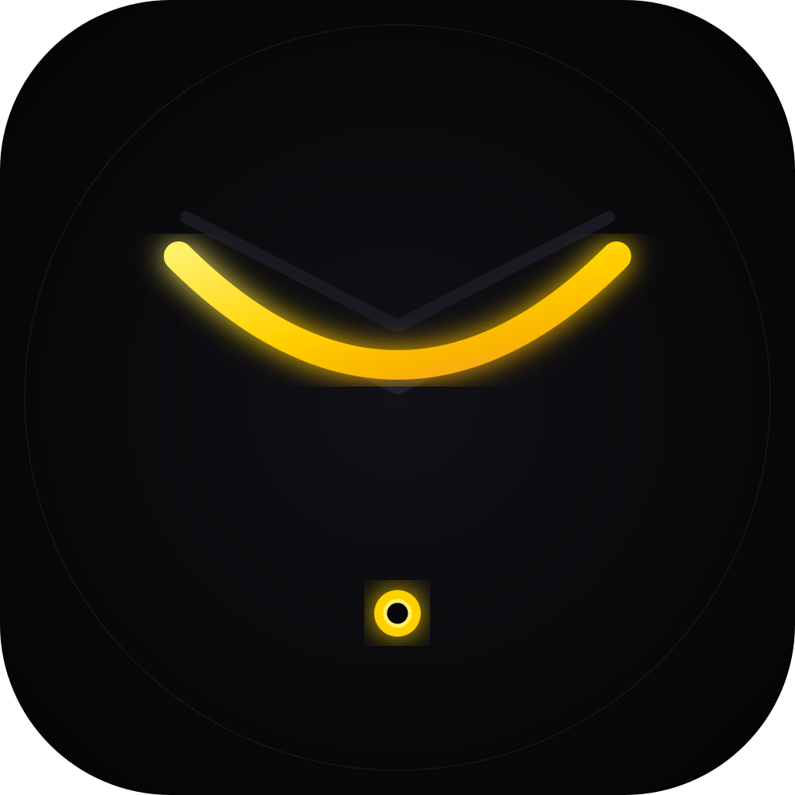
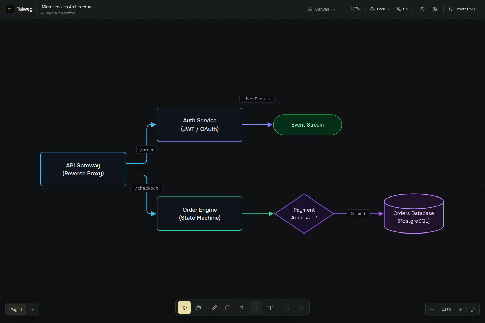

<h1 align="center">Talweg</h1>

A little space to think. Your work stays with you.

  <a href="https://github.com/talweg-app/talweg">Explore the app</a> ·
  <a href="https://github.com/talweg-app/talweg/releases">Downloads</a> ·
  <a href="https://github.com/talweg-app/talweg/tree/main/docs">User guide</a> ·
  <a href="https://github.com/talweg-app/talweg/blob/main/README.ru.md">Русский</a>

<picture>
  <source media="(prefers-color-scheme: light)" srcset="../assets/canvas-light.png" />
  
</picture>

Talweg is a local workspace for diagrams, connected notes and plans. Draw a process, keep the explanation beside it, and split a growing idea into linked pages. Projects are files on your computer.

The Windows and Linux app combines a canvas with Markdown notes, LaTeX formulas, tables, checklists and freehand drawing. Twelve templates give you a starting point for a lesson, research map, project plan or team review.

## Bring someone into the picture

Start a session, share an invitation and approve your guest. You can edit the board together, see each other’s selections and navigate independently. The host keeps the session open; guests can save their own copy.

Recorded in two browser sessions on one computer using a local relay. Cross-network behaviour is still being tested for beta. [How collaboration works](https://github.com/talweg-app/talweg/blob/main/docs/collaboration.md).

## Follow the beta

The current source candidate is **0.1.0-beta.1**. See [Releases](https://github.com/talweg-app/talweg/releases) for builds that have actually been published, or [run from source](https://github.com/talweg-app/talweg#start-here).

Found something awkward? [Report a bug](https://github.com/talweg-app/talweg/issues) or describe the workflow you would like to improve. English and Russian are welcome.

Open source under the [MIT license](https://github.com/talweg-app/talweg/blob/main/LICENSE).
