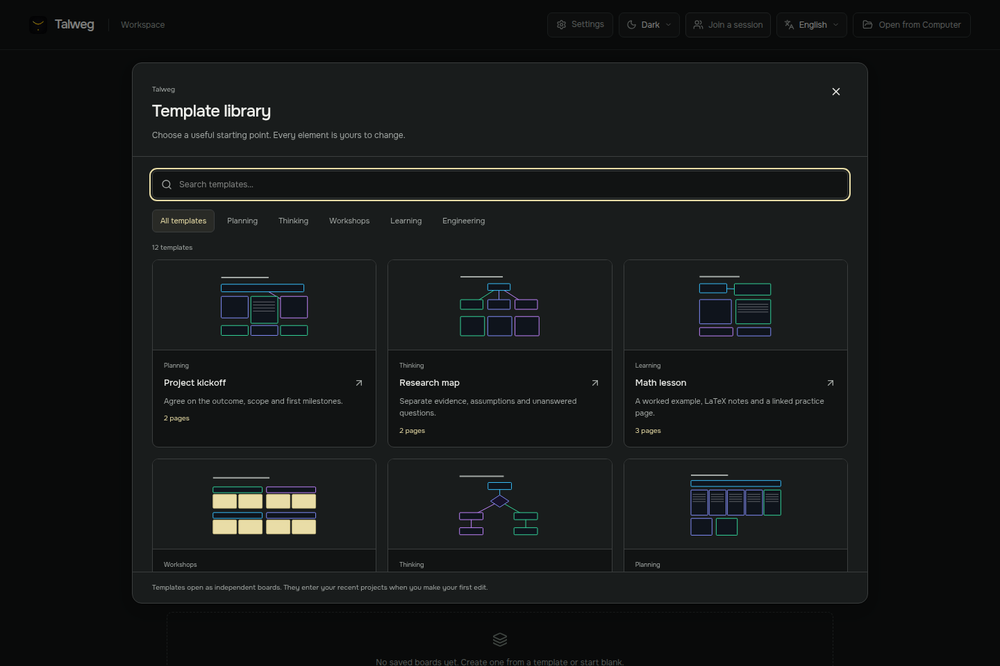
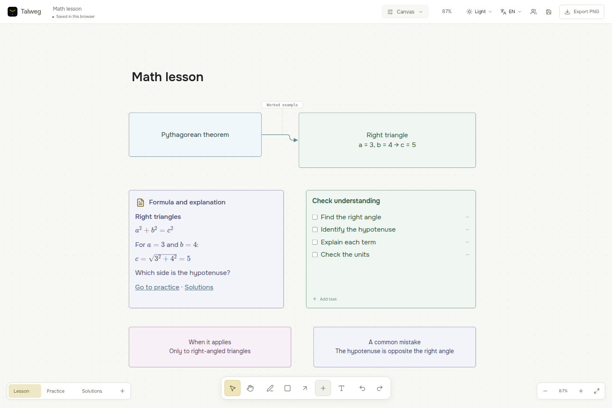
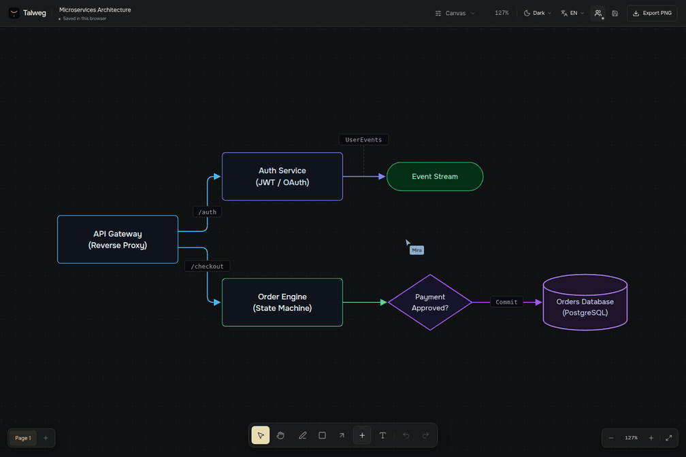

# Как пользоваться Talweg

[Обзор проекта](../README.ru.md) · [English](user-guide.md)

## Первая доска

На главном экране выберите пустой холст или откройте библиотеку шаблонов. Просмотренный шаблон становится вашим рабочим проектом после изменения или явного сохранения. Новая копия не меняет исходный пример.

Нажмите название сверху, чтобы переименовать доску. Кнопка «+» внизу и правый клик по пустому месту открывают каталог элементов: фигуры, текст, таблицы, списки задач, изображения и Markdown-заметки.

## Перемещение и масштаб

Перемещайте холст инструментом руки, удерживая пробел и перетаскивая мышью либо средней кнопкой мыши. В автоматическом режиме колесо мыши меняет масштаб, а прокрутка тачпада перемещает холст. Щипок и Ctrl + колесо приближают к указателю, если система передаёт соответствующие жесты.

Кнопки справа внизу управляют масштабом холста. **Настройки → Общие → Масштаб интерфейса** меняет размер меню и панелей. Для интерфейса также работают Ctrl + плюс, Ctrl + минус и Ctrl + 0. Если устройство определяется неверно, выберите фиксированное поведение колеса в настройках холста.

## Выделение и расположение

Клик выделяет объект, Shift + клик добавляет объект к выделению. Можно выделять рамкой и менять размер через ручки по краям. Текст масштабируется вместе с нодой.

Для нескольких объектов доступны выравнивание, распределение, группы и упорядочивание. Наведите на команду упорядочивания, чтобы увидеть предварительное расположение; нажмите, чтобы применить. Ctrl + Z отменяет результат. Привязка к сетке по умолчанию выключена.

Ctrl + G объединяет выделенное в группу, Ctrl + Shift + G разбирает её. Выделение можно скопировать и вставить на другую доску вместе с внутренними связями и изображениями.

## Текст и ссылки

Двойной клик включает редактирование. Выделите слово или букву, затем измените начертание, размер, цвет или ссылку через панель текста. Ctrl + B, I и U применяются к выбранному фрагменту.

Для внешней ссылки выделите фразу и укажите адрес сайта через кнопку ссылки. Там же можно выбрать страницу и объект этой доски. Выйдите из редактирования, чтобы перейти по ссылке, или используйте Ctrl + клик во время редактирования.

Правый клик по объекту меняет основной цвет текста, выравнивание, заливку и обводку. Оформление всей ноды и отдельного слова действует раздельно: ранее окрашенное слово может сохранить свой цвет.

## Стрелки

Выберите инструмент стрелки или потяните за точку соединения фигуры. У выделенной стрелки можно перепривязать концы. Двойной или правый клик открывает описание связи; очистите поле, чтобы убрать подпись.

Если места на линии мало, подпись может сместиться в сторону и соединиться с ней короткой направляющей. Развёрнутое объяснение лучше оставить в заметке.

## Заметки, изображения и формулы

Нажмите правой кнопкой на объект и выберите «Добавить описание». Кнопка документа появится только на объекте с заметкой. Отдельная Markdown-заметка доступна в каталоге.

В редакторе есть режимы написания и просмотра. Поддерживаются заголовки, списки, цитаты, ссылки, код и формулы: `$a^2 + b^2 = c^2$` внутри строки или отдельный блок `$$`. Это отображение математической записи LaTeX, а не вычислитель.

Локальные фотографии добавляются через каталог, перетаскивание или вставку. В заметку можно загрузить `.md` и скачать её обратно. При экспорте заметки локальные изображения встраиваются в файл. Raw HTML не исполняется; внешние картинки в Markdown автоматически не загружаются.

## Таблицы и задачи

Редактируйте ячейки прямо на холсте. Кнопки таблицы добавляют и убирают строки и столбцы. Правый клик оформляет ячейку, кнопка «Вся таблица» переключает оформление на таблицу целиком. Настройки конкретной ячейки имеют приоритет.

У списка задач редактируются название и пункты; выполненное отмечается галочкой. Шаблоны планирования сочетают задачи с заметками и таблицами.

## Страницы и режимы

Панель слева внизу создаёт, переименовывает, переключает и удаляет страницы. Содержимое страниц независимо. Ссылка в тексте может вести к объекту на другой странице этой же доски.

В верхнем меню доступны холст, схемы и интеллект-карта. В интеллект-карте Tab добавляет дочернюю мысль, Enter соседнюю. Переключение режима не создаёт отдельный проект.

## Сохранение и история

Перед закрытием посмотрите статус под названием доски. Ctrl + S сохраняет копию `.talweg`; экспорт PNG создаёт изображение страницы. PNG нельзя открыть как редактируемый проект.

В установленном приложении проекты по умолчанию лежат в системных «Документах», внутри `Talweg`. Папку можно сменить в настройках, затем перезапустить приложение. Старые файлы автоматически не перемещаются.

Локальная история доступна при подключённой папке проектов. Сохраняйте контрольные точки перед крупной правкой. Старую версию можно скачать или восстановить отдельной доской. Лимиты истории распространяются и на именованные точки, поэтому важные проекты дополнительно копируйте на другой диск.

«Скрыть» меняет текущий список. «Удалить» после подтверждения удаляет проект и его историю. В браузерном режиме без файловой библиотеки данные хранятся в профиле браузера: другой порт, адрес или профиль может показывать другую библиотеку. Подробнее: [файлы и восстановление](files-and-recovery.md).

## Совместная работа

1. Хост открывает доску и нажимает **Совместная работа → Начать сессию**.
2. Копирует приглашение `talweg://` и передаёт гостю целиком, включая часть после `#`.
3. Гость запускает свой Talweg, выбирает **Подключиться к сессии**, вставляет приглашение и подключается.
4. Хост подтверждает запрос. После этого гость может редактировать доску.

Курсор, выделение объектов, движение, изменение размера и рисование видны другим участникам. В текстовом редакторе видны каретки и выделенные фрагменты. Камера и выбранная страница у каждого свои.

Хост должен оставаться в сессии. Выйдя, гость не получает постоянно доступную серверную комнату. Команда **Сохранить независимую копию** создаёт его собственную доску; она больше не синхронизируется с оригиналом. Уже полученные хостом изменения остаются в проекте.

По умолчанию разрешены три гостя, в настройках хоста можно выбрать от одного до восьми. Каждый новый участник требует подтверждения. Для подключения используются публичные сервисы обнаружения; некоторые сети требуют настройки TURN. Приглашение содержит данные доступа, храните его как приватную ссылку.

Версия для macOS пока отложена. Перед публикацией автор проверил Windows и P2P вручную; в сетях с ограничениями может понадобиться TURN. Запись выше сделана на одном компьютере. [Подробности подключения](collaboration.md).

## Основные сочетания

| Клавиши | Действие |
| --- | --- |
| V / H / P | Выделение / рука / ручка |
| R / D / A / T | Прямоугольник / ромб / стрелка / текст |
| Пробел + перетаскивание | Перемещение холста |
| Ctrl + C / X / V | Копировать / вырезать / вставить выделение |
| Ctrl + D | Дублировать |
| Ctrl + G / Ctrl + Shift + G | Объединить / разгруппировать |
| Ctrl + Z / Ctrl + Shift + Z или Ctrl + Y | Отменить / повторить |
| Ctrl + S | Сохранить файл проекта |
| Ctrl + плюс / минус / 0 | Масштаб интерфейса |
| Tab / Enter в интеллект-карте | Дочерняя / соседняя мысль |
| Delete / Backspace | Удалить выделенное |
| Escape | Отменить взаимодействие или выйти из инструмента |

В поле ввода обычное редактирование текста имеет приоритет над инструментами холста.
